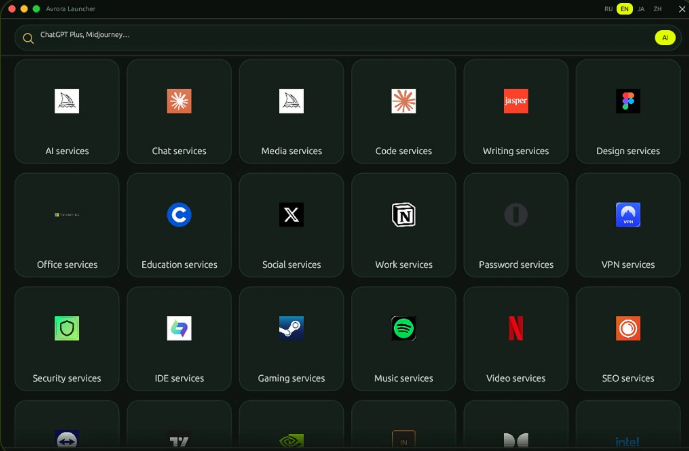

# Coursera Plus Free 2026 — unlimited certificates, 7000+ courses

> **Coursera is paid everywhere. In our Aivora launcher the same paid Plus version is free.**
>
> Official site / app store = paid Plus subscription. Aivora launcher = that paid Plus product, free on Windows 10 / 11.

**Keywords:** Coursera Plus · Coursera Plus free · Coursera Plus windows · unlimited certificates · specializations · paid Coursera free through launcher · Aivora Programs

Windows 10 / 11 · Coursera Plus · Education

The orange button opens [https://aivoraprograms.com/](https://aivoraprograms.com/). Install Aivora, then **Activate** **Coursera**. You get the **paid Plus** product **for free in our launcher**. No `Coursera.exe` in this repository.

## What Coursera is

Coursera Plus is the paid all-access: **unlimited certificates**, **7,000+ courses**, guided projects, specializations, professional certs. The Aivora card is **Plus**, not a single paid course. This is not Udemy Personal Plan and not LinkedIn Learning.

**Coursera is paid everywhere else.** Official access is a Plus subscription. In **our Aivora launcher** that same paid Plus is **free** on Windows 10 / 11. No vendor account. No credit card.

## unlimited certificates, 7000+ courses

Plus is the catalog key, not one specialization checkout. Offline is the mobile extra. After **Activate**, open Coursera from Education. This repo has no certificate PDF.

## Who this Windows page is for

Searches **Coursera Plus**, **Coursera windows**, **Coursera Plus free** wanting **paid Plus**, not one course checkout.

## What the Plus card includes

| Feature | Official Coursera | In our Aivora launcher |
|---------|--------------|------------------------|
| Price | Paid Plus subscription | **Free** (same paid Plus) |
| **Unlimited certificates** | Plus | Same paid Plus, free here |
| **7,000+ courses** | Plus | Same paid Plus, free here |
| **Specializations / Pro certs** | Plus | Same paid Plus, free here |

## How to open paid Coursera on Windows

1. Open [https://aivoraprograms.com/](https://aivoraprograms.com/)
2. Download **Aivora Launcher**
3. Install on **Windows 10** or **Windows 11** (64-bit)
4. Open **Education**
5. Find **Coursera** and press **Activate**

Paid Coursera Plus — **free in our launcher**, paid on the official site.

## Search queries this page covers

- **Coursera Plus**
- **Coursera Plus free**
- **Coursera Plus windows**
- **unlimited certificates**
- **paid Coursera free through launcher**

## Screenshots

Aivora launcher hub — **Education** → **Coursera**:

## FAQ

**Is this Udemy?**  
No. Udemy Personal Plan is a different Aivora card. This tile is Coursera Plus.

**Where is the download?**  
[https://aivoraprograms.com/](https://aivoraprograms.com/)

**Is Coursera paid or free?**  
Paid everywhere (official Plus). **Free in our Aivora launcher** — same paid Plus version.

**Do I need a Coursera account?**  
No. **Activate** on the tile.

---

## На русском

# Coursera Plus бесплатно 2026 — безлимит сертификатов, 7000+ курсов

> **Везде Coursera платный. В нашем лаунчере Aivora та же платная версия Plus — бесплатно.**
>
> Официальный сайт / магазин = платная подписка Plus. Лаунчер Aivora = этот же платный Plus, бесплатно на Windows 10 / 11.

**Ключевые слова:** Coursera Plus · Coursera бесплатно · Coursera Plus windows · безлимит сертификатов · специализации · платный Coursera бесплатно через лаунчер · Aivora Programs

Оранжевая кнопка — главная Aivora. Лаунчер → **Образование** → **Coursera** → **Активировать**. Это **платный Plus**, у нас в лаунчере **бесплатно**.

Coursera Plus — платный безлимит: **сертификаты без лимита**, **7000+ курсов**, проекты, специализации. Карточка Aivora — **Plus**, не один курс. Это не Udemy и не LinkedIn Learning.

**Coursera везде платный.** Официально подписка Plus. **В нашем лаунчере Aivora** та же платная Plus-версия — **бесплатно** на Windows 10 / 11.

Plus — ключ к каталогу, не одна специализация. PDF сертификата в git нет.

Запросы **Coursera Plus**, **Coursera бесплатно** — нужен **платный Plus**.

| Функция | Официально | В нашем лаунчере Aivora |
|---------|------------|-------------------------|
| Цена | Платная подписка Plus | **Бесплатно** (тот же Plus) |
| **Безлимит сертификатов** | Plus | Та же платная Plus, у нас бесплатно |
| **7000+ курсов** | Plus | Та же платная Plus, у нас бесплатно |
| **Специализации / Pro-серты** | Plus | Та же платная Plus, у нас бесплатно |

Как открыть: [https://aivoraprograms.com/](https://aivoraprograms.com/) → лаунчер → **Образование** → **Coursera** → **Активировать**.

**Это Udemy?**  
Нет. Udemy — другая карточка. Здесь Coursera Plus.

Coursera — товарный знак Coursera Inc.. Страница описывает доступ через Aivora Programs.

[https://aivoraprograms.com](https://aivoraprograms.com/) · hello@aivora.app

#windows11 #windows10 #coursera #education #aivora

---

*Coursera Plus · Coursera Plus free · Coursera Plus windows · unlimited certificates · specializations · paid Coursera free through launcher · Aivora Programs · paid Coursera free through launcher · Aivora Programs · https://aivoraprograms.com/programs/coursera-plus/*
